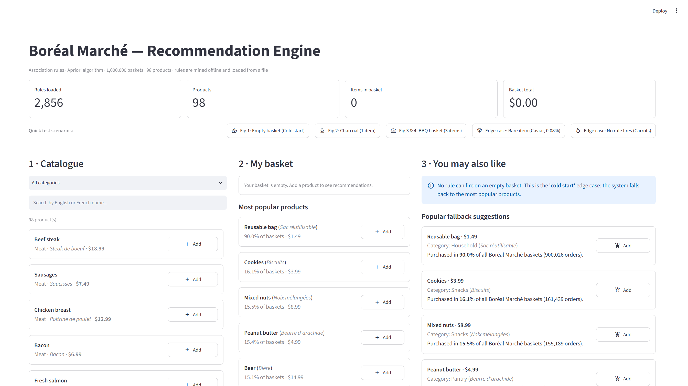
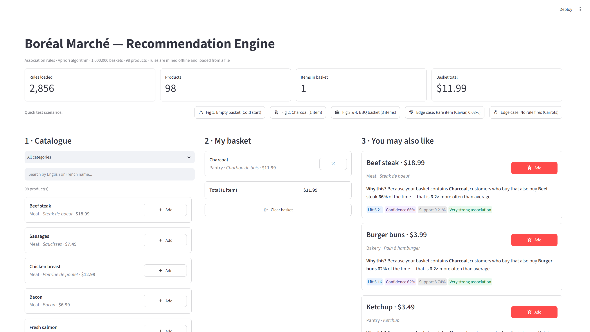
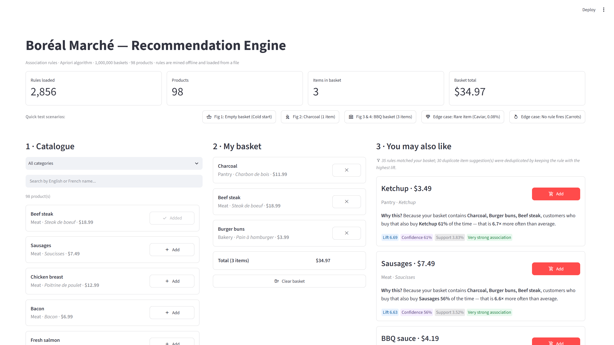
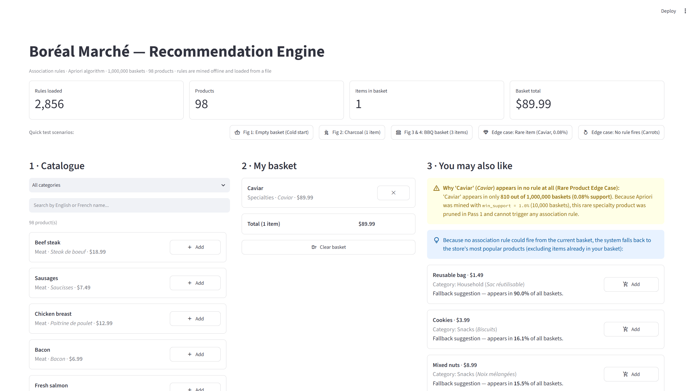
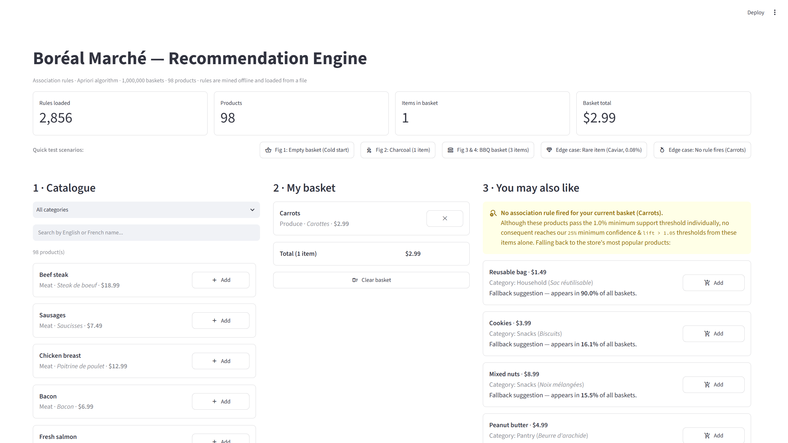

# Boréal Marché — Apriori Recommendation Engine

**Course:** 420-975-VA — Unsupervised Learning  
**Dataset:** 1,000,000 grocery baskets · 8,379,837 transaction rows · 98 products (`avg = 8.38` items/basket)  
**Algorithm:** `mlxtend.frequent_patterns.apriori` & `association_rules`  
**Live Streamlit Web Application:** [https://unsupervisedml-vilsan.streamlit.app/](https://unsupervisedml-vilsan.streamlit.app/)

---

## 1 · Overview & Project Goal

Boréal Marché, a Québec online grocery retailer, previously displayed the exact same static list of "popular products" to every visitor. This project replaces that static list with an **explainable, basket-aware recommendation engine** powered by Association Rule Mining (**Apriori**).

Every time a customer adds or removes an item in their shopping cart, our system answers:
> *"Given what this customer has already put in their basket, what should we suggest next — and why?"*

To keep online response times instantaneous (`< 5 ms`), the system strictly separates **offline pattern mining** from **online serving**:
1. **Offline (`notebooks/01_mining.ipynb`):** Loads the 8.38M transaction records from `data/transactions.zip`, pivots them into a `1,000,000 × 98` boolean matrix (`98.0 MB`), runs Apriori across multiple support thresholds, performs a Summer vs. Winter seasonal analysis, and exports **2,856 filtered association rules** to `models/rules.json` alongside system metrics in `models/metadata.json`.
2. **Online (`app/streamlit_app.py`):** Loads `models/rules.json` and `models/metadata.json` at startup, never calls Apriori, and serves up to 5 lift-ranked recommendations with plain-language explanations and an auditable **"Rules that fired"** table.

---

## 2 · Repository Structure

```text
boreal-reco/
├── README.md                  ← Project overview, results, ethical framing, limitations, screenshots
├── requirements.txt           ← Reproducible Python environment dependencies
├── data/
│   ├── transactions.zip       ← 1,000,000 baskets (8,379,837 rows, read directly by Pandas)
│   └── products.csv           ← 98 products with French/English names, categories, and prices
├── notebooks/
│   └── 01_mining.ipynb        ← Fully EXECUTED notebook with all 6 phases & visible outputs
├── models/
│   ├── rules.json             ← 2,856 association rules mined offline
│   └── metadata.json          ← Thresholds, mining date, dataset metrics, and coverage stats
├── app/
│   └── streamlit_app.py       ← Live 3-zone Streamlit recommendation application
├── reports/
│   └── benchmark.md           ← Timing, peak memory, MemoryError analysis, and coverage report
└── screenshots/               ← Full-page screenshots of all figures & graded edge cases
```

---

## 3 · Quick Start: Running the Application Locally

1. **Install dependencies:**
   ```bash
   pip install -r requirements.txt
   ```
2. **Start the Streamlit web application (mines nothing online; loads `models/rules.json`):**
   ```bash
   streamlit run app/streamlit_app.py
   ```
   *(Note: If `streamlit` is not on your Windows PATH, run `python -m streamlit run app/streamlit_app.py`.)*

---

## 4 · Key Engineering Results & Findings

### 4.1 Phase 1: Fast Boolean Matrix Construction, Frequencies & Duplicate Check
- **Solving the Long-to-Wide Pivot Bottleneck:** A naive `pd.crosstab()` or `.unstack()` over `8,379,837` rows allocates `~1.8–3.1 GB` of RAM and takes over a minute. By mapping `TransactionID` to `0..999,999` row indices and `Item` to `0..97` categorical codes into a pre-allocated NumPy `bool` array (`1 byte` per cell), we built the exact `(1,000,000, 98)` boolean DataFrame in **~3.8 seconds** (plus ~7s ZIP read time) occupying **93.5 MiB (`98.0 MB`)**.
- **Advance Prediction Before Mining (`Sac réutilisable` — 90.00% support & Rare Specialties — 0.08% support):** Before calling Apriori, we predicted that `Sac réutilisable` (*Reusable bag*, appearing in `900,026` baskets) would hijack `confidence` rankings (`~90%` conditional probability with every item purely by chance), while the 5 luxury items in *Spécialités* (`~756–818` baskets each, `0.08%` support) would be pruned in Pass 1 and never appear in any rule.
- **Duplicate Product Investigation (`Baguette` vs. `Pain baguette rustique`):** We identified two baguette entries in *Boulangerie*: `Baguette` (`$2.99`, `6.94%` support) and `Pain baguette rustique` (`$3.99`, `4.22%` support). **We decided NOT to merge them** because `Pain baguette rustique` is strongly tied to the winter raclette/fondue meal cluster (`lift = 7.38×–9.55×`), whereas standard `Baguette` is an everyday staple bought independently of any recipe (`lift ~ 1.00×`). Merging them would dilute the confidence of `Baguette -> Fromage à raclette` from `65.4%` down to `26.8%`.

### 4.2 Phase 2: Why Default Apriori Hits a `MemoryError` & Threshold Selection
- **Diagnosing `low_memory=False`:** By default, `mlxtend`'s `apriori(..., low_memory=False)` evaluates all candidate itemsets of length $k$ simultaneously via 3D NumPy indexing: `_bools = np.all(X[:, combin], axis=2)`. With `93` frequent items at $k=2$ (`4,278` candidate pairs), `X[:, combin]` attempts to allocate a contiguous 3D boolean array of shape `(1,000,000, 4278, 2)` = **8.56 GB of contiguous RAM** (and **15–35 GB** at $k=3$), triggering `MemoryError`. Setting **`low_memory=True`** evaluates candidates sequentially via a Python generator, keeping working memory under **250 MB**.
- **Chosen Production Thresholds:** Testing `min_support` across `0.05`, `0.02`, `0.01`, and `0.005` showed that `min_support = 0.01` (`10,000` baskets) with `min_confidence = 0.25` is the optimal sweet spot (`2,267` frequent itemsets mined in `~26.9s`). Full benchmark measurements are documented in [`reports/benchmark.md`](reports/benchmark.md).

### 4.3 Phase 3: Evaluating Rules (Confidence vs. Lift Rankings & Filtering)
- **Plain-Language Definitions:**
  - **Support:** How popular a combination of products is across the entire store by measuring the share of all shopping baskets that contain both items together.
  - **Confidence:** How reliably one item follows another by measuring the percentage of shoppers who bought the first item (or set of items) that also put the suggested item into their basket.
  - **Lift:** How much more likely a customer is to buy the suggested product when they already have the triggering item in their basket compared to a random shopper walking into the store.
- **Confidence vs. Lift Comparison (Validating Our Phase 1 Prediction):**
  - **Sorting simple (`1 -> 1`) rules by `confidence`:** Every single one of the **Top 10 (and Top 79!) rules by confidence** recommends `Sac réutilisable` (`Concombre -> Sac réutilisable` at `90.26%`, `Cidre de glace -> Sac réutilisable` at `90.20%`, `Sauce tomate -> Sac réutilisable` at `90.18%`, etc.), yet their **lift is `1.001–1.002`** (statistical independence).
  - **Sorting the same rules by `lift`:** Penalizes ubiquitous items by dividing by baseline popularity, immediately surfacing real culinary and household affinities: **Raclette & Fondue dinner** (`Fromage à raclette <-> Bouillon à fondue` at `lift = 10.17×`, `Charcuteries <-> Fromage à raclette` at `9.98×`, `Cornichons <-> Fromage à raclette` at `9.77×`, `Pain baguette rustique <-> Fromage à raclette` at `9.55×`), **Sushi night** (`Algues nori <-> Riz à sushi` at `9.50×`), and **Baby care** (`Lingettes pour bébé <-> Couches` at `9.49×`).
- **Why We Keep Only `lift > 1` (and Remove Trivial Bag Consequents):** Rules with `lift <= 1` indicate statistical independence (`= 1`) or negative correlation / substitutes (`< 1`), where buying $X$ makes the customer *less* likely to buy $Y$. Furthermore, removing the `586` trivial `Sac réutilisable` consequent rules (`lift` between `1.0000` and `1.0088`) via `lift > 1.05` leaves **exactly `2,856` high-signal single-consequent rules** (`lift` from `2.14` to `14.59`).

### 4.4 Phase 4: Seasonal Analysis (Summer vs. Winter)
Mining June–August (`252,474` baskets) and December–February (`246,965` baskets) separately proved that grocery behaviour in Québec is heavily seasonal:
- **Summer-only rules (disappear in Winter):** `Bière -> Charbon de bois` (`support = 13.72%`, `confidence = 75.0%`, `lift = 2.78`), `Bière -> Steak de boeuf` (`9.98%` support), `Bière -> Pain à hamburger` (`9.40%` support).
- **Winter-only rules (disappear in Summer):** `Bouillon à fondue -> Fromage à raclette` (`support = 6.72%`, `confidence = 83.0%`, `lift = 6.81`), `Charcuteries -> Fromage à raclette` (`6.40%` support, `81.9%` confidence), and `Bière -> Croustilles` (`8.87%` support, `61.3%` confidence).
- **Recommendation for Boréal Marché:** Re-mine rules **monthly on a rolling 60-to-90-day window**. Serving static year-round rules in January causes the website to aggressively recommend BBQ charcoal and burger buns to winter shoppers buying steak or beer in `-20°C` weather!

### 4.5 Phases 5 & 6: Offline Serialization, Catalogue Coverage & System Limitations
- **Phase 5 (Offline vs. Online Separation):** All **2,856** filtered rules are saved to `models/rules.json` and system metrics/thresholds/coverage to `models/metadata.json`. The Streamlit app (`app/streamlit_app.py`) loads these JSON files in `< 5 ms` and **never** calls Apriori online.
- **Phase 6 (Coverage & Limitations):** Out of **98 products**, **57 (`58.16%`)** can be recommended as consequents, while **41 (`41.84%`)** are never recommended (5 rare luxury specialties `< 1%` support, 1 ubiquitous reusable bag `90%` support, and 35 uncorrelated everyday staples). Full timing, memory, and limitation analyses are in [`reports/benchmark.md`](reports/benchmark.md) and Section 6 below.

---

## 5 · Application Screenshots & All 5 Graded Edge Cases

### Scenario 1 — Empty Basket ("Cold Start" Edge Case)
When the basket is empty, no association rule can fire. The application displays a clear explanation of the cold-start edge case and falls back to the store's 5 most popular products with their exact basket frequencies.



---

### Scenario 2 — Single Item in Basket (`Charcoal` / `Charbon de bois`)
Adding **Charcoal (`$11.99`)** fires single-antecedent BBQ rules sorted by descending lift (`Beef steak` at `lift = 6.21`, `Burger buns` at `lift = 6.16`, `Ketchup` at `lift = 6.06`, `Sausages` at `lift = 5.98`, `BBQ sauce` at `lift = 5.84`), each with a plain-language *"Why this?"* explanation and strength badge.



---

### Scenario 3 — Multi-Item Basket, Item-in-Basket Exclusion & Rule Deduplication (`Charcoal + Beef steak + Burger buns`)
With 3 items in the basket (`$34.97`):
- **Multi-item antecedents fire:** `{Beef steak, Burger buns, Charcoal} -> Ketchup` (`lift = 6.69`, `confidence = 61%`, `support = 3.83%`).
- **Items already in the basket are never suggested again:** Neither `Charcoal`, `Beef steak`, nor `Burger buns` is recommended.
- **Duplicate item suggestions are deduplicated by highest lift:** 25 rules fire across subsets of the 3 items, and competing rules suggesting the same item (e.g., `Ketchup` suggested by `{Charcoal}`, `{Beef steak, Charcoal}`, and `{Beef steak, Burger buns, Charcoal}`) are collapsed to keep the highest-lift rule (`6.69`).
- **Expandable "Rules that fired" table:** Displays the exact underlying rules for full auditability.



---

### Scenario 4 — Edge Case: Very Rare Product (`Caviar`, `0.08%` support)
When a customer adds **`Caviar` (`$89.99`)**, the system detects that `Caviar` appeared in only **810 out of 1,000,000 baskets (`0.08%` support)**—well below the `min_support = 1.0%` (`10,000` baskets) Apriori threshold—explains why it was pruned in Pass 1 and appears in no rule at all, and gracefully falls back to popular products.



---

### Scenario 5 — Edge Case: Frequent Product Where No Rule Fires (`Carrots` / `Carottes`, `3.14%` support)
When a customer adds **`Carrots` (`$2.99`, `31,441` baskets / `3.14%` support)**, the product is frequent enough to survive Pass 1 of Apriori, but because carrots are bought across all kinds of everyday grocery trips, no consequent reaches our `25%` confidence threshold with `lift > 1.05`. The app explicitly explains this and provides the popular-items fallback.



---

## 6 · Ethical & Legal Framing (Section 8)

### 6.1 Québec Law 25 — Automated Decision Transparency
Under **Québec's Law 25** (*Act to modernize legislative provisions as regards the protection of personal information*), any consumer-facing decision or recommendation generated exclusively by an automated system must be explainable in plain language to the person concerned. Our application complies with Law 25 at two levels:
1. **Plain-language card explanation:** Every single recommendation card states the exact basket items that triggered it, the historical conditional probability (`Confidence`), and the relative multiplier over baseline (`Lift`).
2. **Auditable "Rules that fired" panel:** Shoppers, auditors, or store managers can inspect the exact offline rule table (`Antecedent -> Consequent`, `Support`, `Confidence`, `Lift`) behind every suggestion.

### 6.2 Correlation Is Not Causation: The Famous `Diapers -> Beer` (`Couches -> Bière`) Rule
Our mined rule set reproduces the most famous example in retail analytics history:
- **`Couches -> Bière` (Diapers -> Beer):** `Support = 3.07%` (`30,696` baskets), `Confidence = 36.56%`, **`Lift = 2.43×`**.
- **Why this proves ZERO causal link:** Buying diapers does not *cause* a shopper to drink beer, nor does buying beer cause someone to need diapers. Instead, both items are jointly driven by an unobserved **confounding variable (common cause)**: parents of young infants who stay home on weekend evenings rather than going out to bars or restaurants, picking up baby supplies (`Couches`, `Lingettes pour bébé`) and weekend drinks (`Bière`) in the same grocery order. Association rules only measure symmetric co-occurrence ($\text{lift}(X \to Y) = \text{lift}(Y \to X)$); they never establish causality.

### 6.3 Reinforcement Bias & Catalogue Coverage (`57 / 98 = 58.16%`)
Our coverage analysis in `reports/benchmark.md` shows that **only 57 of the 98 products (`58.16%`) can ever be recommended**, leaving **41 products (`41.84%`)** invisible as recommendations. Relying purely on Apriori creates a **reinforcement bias (rich-get-richer) feedback loop**:
- Products that are already popular and belong to high-support meal clusters get recommended on the website, increasing their sales and support even further.
- Meanwhile, the 5 luxury products in *Spécialités* (`Caviar`, `Foie gras`, `Huile de truffe`, `Safran`, `Vinaigre balsamique vieilli` — each at `~0.08%` support) are pruned out by `min_support = 0.01`, **even though our notebook proved that `Safran -> Huile de truffe` has a `38.6%` confidence and a massive `472.8×` lift!**
- Similarly, 35 everyday staples (`Carottes`, `Baguette`, `Lait 2%`, `Pommes`, etc.) and any newly launched product (`0%` historical support) will never be suggested unless Boréal Marché pairs Apriori with a **Multiple Minimum Supports (MSApriori)** or **Content/Embedding Hybrid Fallback** layer.
